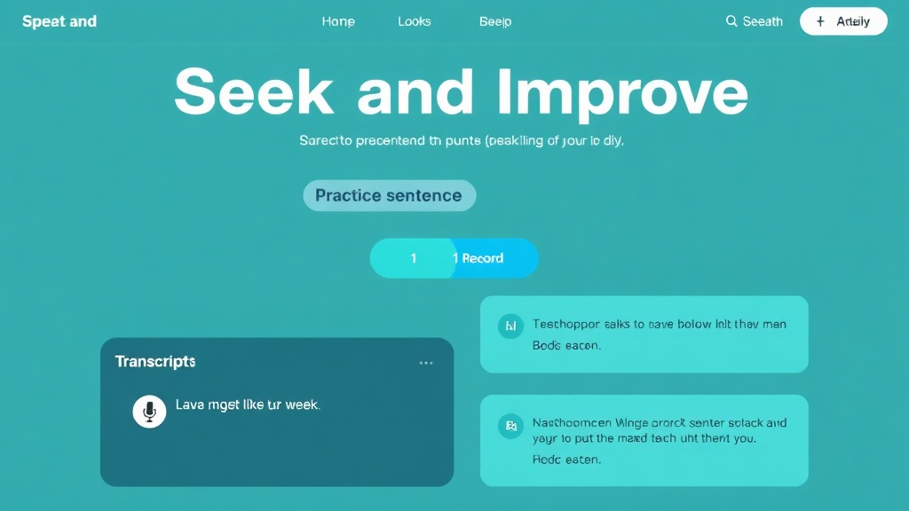

# Speak and Improve

Speak and Improve helps people practise speaking or singing a line and get feedback. Pick a practice sentence or type your own, record your voice in the browser, and Pollinations transcribes the recording and compares it with the target line.

## How it works

- Sign in with Pollinations Pay in the app. Requests use your own Pollinations balance.
- Record with the browser microphone.
- Transcription uses a Pollinations audio model.
- Feedback uses a Pollinations text model for match score, clear words, sounds to practise, and one short drill.
- Optional model reading uses a Pollinations text-to-speech voice.

## Run locally

Open `index.html` in a browser, or serve the folder with any static file server.

